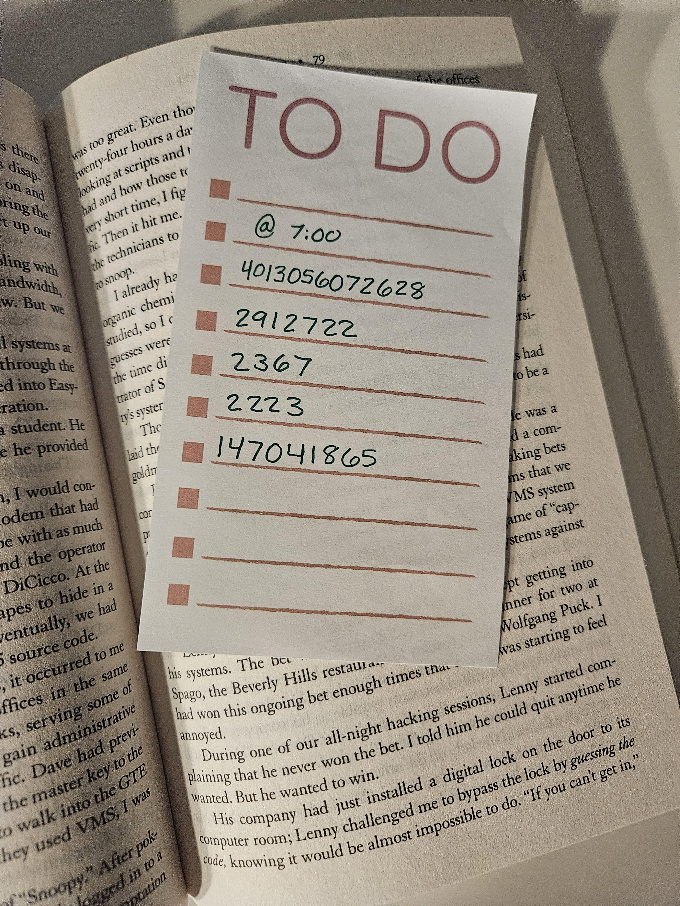

# CASE 01 · THE VANISHING ASTRONOMER

## Day 5: Not-So-Safe Message

**Difficulty:** Medium

> **CHALLENGE**
>
> The cops use the code to the safe found in the audio file and see assorted papers, among them is a book. Hidden inside is a post-it note. Can you help them decode the message?

## What was inside the safe

The lock code from Day 4 opened onto a stack of papers and one book: Kevin Mitnick's Ghost in the Wires. Tucked inside it, a torn post-it note with five handwritten numbers, no labels, no context.

<p align="center"></p>

<p align="center"><em>The post-it, folded inside the book, five numbers and nothing else.</em></p>

```
4013056072628        2912722      2367        2223        147041865
```

## Throwing ciphers at a wall

This one didn't want to give in easily. Ran the numbers through a stack of standard cipher identifiers on boxentriq.com. A1Z26, straight digit substitution, phone-keypad multi-tap, columnar transposition, none of it produced anything readable. Every attempt was a dead end dressed up as a maybe.

Stepped back from the numbers and looked at the book itself instead. Chapter 8, "Lex Luthor". It turns out Ghost in the Wires is genuinely known for hiding real embedded cryptograms at the start of every chapter, a detail that felt too on-the-nose to be a coincidence. Whoever built this puzzle picked this book on purpose.

## The actual cipher

The five numbers weren't a substitution or a transposition. They were bijective base-26, each full number read as one large integer and converted straight to letters (A=1, B=2, up through Z=26, no zero digit, so a number like 27 becomes AA rather than wrapping around). Feed the whole string through and it stops looking like noise:

```
SEPTEMBER     FIRST    CMA    CGM    LITANI
```

Four clean words and a fifth fragment. CMA CGM is a real container shipping line, and Litani turned out to be the name of one of their actual ships. The date was missing its last two digits though, a month and a day with no year attached.

## Filling the gap

That's where the book's own page came back into it. The visible text in the photo has one word italicised: guessing, in a line about bypassing a lock by guessing the code. Too pointed to ignore twice in one puzzle. Took it as permission rather than a decode step, filled in the current year, and the date completed itself: September 1st, 26.

Checked the ship afterward rather than just trusting the name fell out of a cipher. CMA CGM Litani is a real, active container ship, IMO 9705055, flagged in Malta. A decoded string is only as good as what it points to, and this one pointed to something real.

> **FLAG**
>
> `SEPTEMBER FIRST 26 CMA CGM LITANI`
