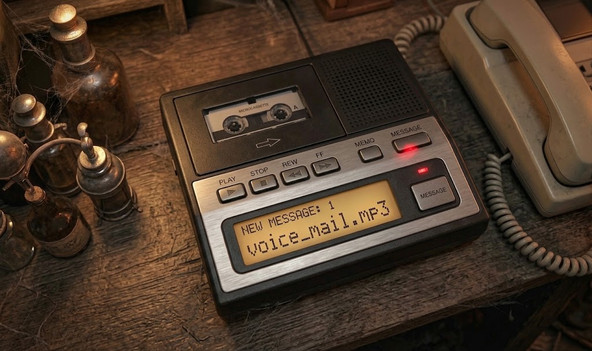
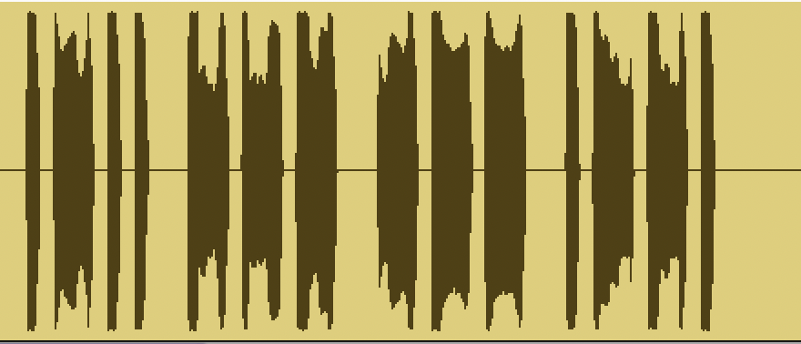
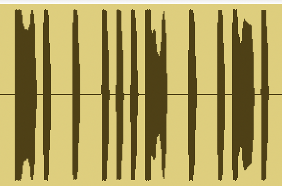
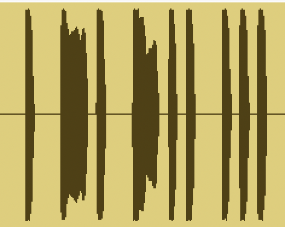

# Ghost of OSINT Station, Day 17: Voice Mail

Woke up on the floor again, no memory of the last day, white dust on my clothes, a burnt-ozone smell in the air. Classic. But this time there was a prop waiting for me that actually belongs in this century's grandfather's basement: a black plastic answering machine, red light blinking, one new message queued up and named exactly like it wanted to be found.

> "The digital LCD screen glows with an amber backlight, displaying a single unread audio file: voice_mail.mp3. Whatever happened before the server wipe, whoever is orchestrating this sick experiment left this message intentionally. I'm exhausted, mentally drained, and terrified, but if I want answers to who I am and why I'm trapped in this endless loop, I have no choice but to press play."



*The answering machine. "NEW MESSAGE: 1, voice_mail.mp3", patiently waiting.*

## Skipping the hard way

The competition clock does not care how elegant your signal analysis is. So instead of reaching for a spectrogram, this one went straight into a Morse code analyser online, the whole audio file, dropped in raw. No filtering, no Goertzel algorithms, no hand-measuring pulse widths. Out came three groups of dots and dashes, and out came three words with them.

The proof is right there in the waveform once you actually look at it, three screenshots, three chunks of clean rectangular pulses, thin for a dot, wide for a dash:



`.-.. --- --- .-- = L O O P`



`-. . ...- . .-. = N E V E R`



`. -. -.. ... = E N D S`

Three words, read in order: LOOP, NEVER, ENDS. Which is not just a valid phrase, it is the phrase, the one this whole case has been circling since "Loop 14" showed up in Day 15's server logs. The puzzle answered its own subplot.

## The part that actually took time

Having the words was the easy 90%. Getting them into the box correctly was the other 90%. The flag format on screen was:

```
flag{XXXX_XXXXX_XXXX]
```

Selected it, copied it, went to swap the placeholders for LOOP_NEVER_ENDS. In the rush, the selection started one character too late. What actually got copied was:

```
lag{XXXX_XXXXX_XXXX]
```

Missing the f. Invisible kind of missing, the kind where your eyes just autocorrect it back in without asking permission. Submitted `lag{LOOP_NEVER_ENDS}`. Rejected. Tried it in lower case, just to rule that out. Rejected. Left, tried a second Morse tool, then a third, decoding the audio all over again from scratch each time, getting the exact same three words every single time, because the words were never the problem.

Came back to the original answer, actually read it letter by letter instead of skimming it, and there it was: no f. Added it back. Submitted.

**Flag: `flag{LOOP_NEVER_ENDS}`**

Solved a Morse cipher in one shot and then got stuck for three tool-switches on a single missing letter. The flag was never the bottleneck. The flag was lagging.
